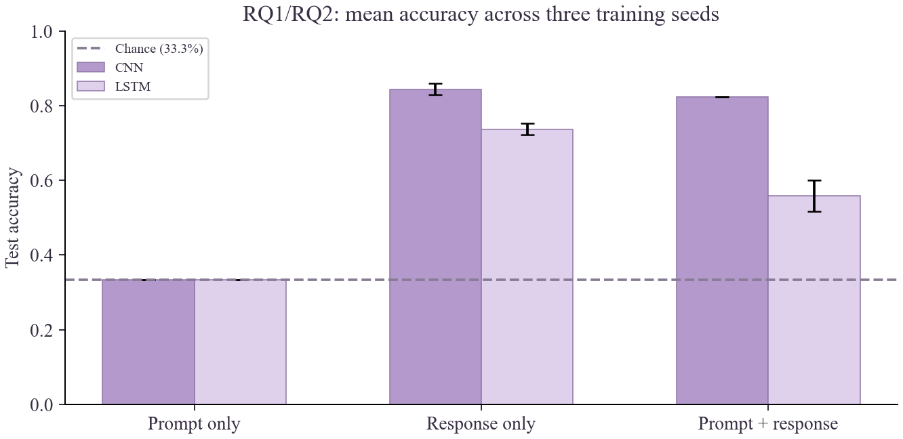
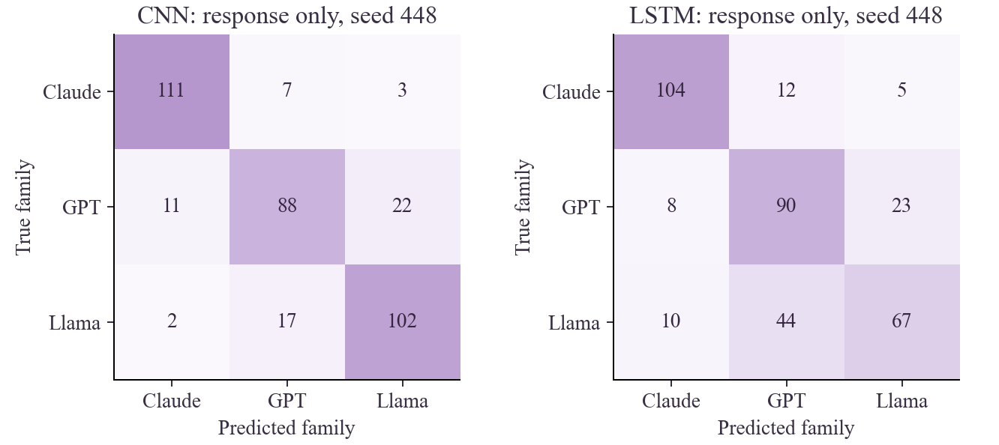
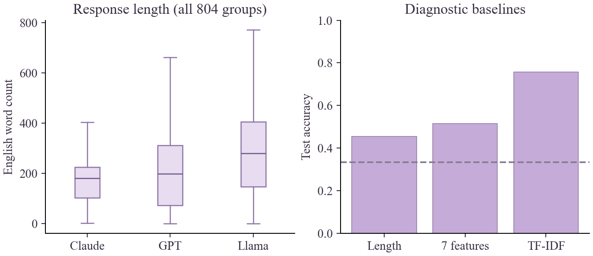

# Who Wrote It? Identifying LLMs from Their Responses

CMPSC 448 | Midterm Project | October 11, 2026

Team leader: Bingjie Yan | Team member: Siyuan Zhou

### Abstract

Can a classifier tell which language model wrote an answer? We tested this using public answers from GPT-4, Claude 2 and Llama 2 70B Chat. The dataset contains 804 shared prompts and 2,412 answers. We trained a CNN and a bidirectional LSTM using the prompt, the answer, or both. Averaged over three training seeds, answer-only accuracy was 84.4% for the CNN and 73.6% for the LSTM. Adding the prompt did not improve either model. Further tests examined answer length, vocabulary and formatting. The results show that these three model releases can often be distinguished on this dataset.

### 1. Problem definition and research questions

We treated the task as three-class classification, with Claude, GPT and Llama as labels. For RQ1, we used only the answer to predict its source. For RQ2, we compared prompt-only, answer-only and combined inputs. We also studied length, vocabulary and formatting for RQ4. We did not run the cross-domain experiments in RQ3.

### 2. Dataset construction

We downloaded the released AlpacaEval answers [1]. The GPT and Claude files each contain 805 entries; the Llama file contains 804. After matching prompts with whitespace normalized, 804 prompts had an answer from every model. We kept these complete groups so that each class had the same prompts and sample count. The retained answers were nonempty, and the duplicate checks removed no groups.

| Split | Prompt groups | Examples | Examples per family |
| --- | --- | --- | --- |
| Train | 562 | 1686 | 562 |
| Validation | 121 | 363 | 121 |
| Test | 121 | 363 | 121 |

We sorted the shared prompts, shuffled them with seed 448, and used a 70/15/15 split. All three answers to a prompt stayed together. This prevents the same question from appearing in both training and testing. The source URLs, upstream revision and file hashes are recorded in data/manifest.json. Model names and source labels were excluded from the input text.

## 3. CNN and RNN implementation

### Text representation

We lowercased the text and tokenized English words, numbers, punctuation and newlines. Keeping punctuation and newlines let the models use formatting as well as vocabulary. Each input setting used a vocabulary built only from its training texts, with at most 12,000 entries. PAD represents padding, UNK represents unseen tokens, and SEP separates the prompt from the answer. We kept up to 96 prompt tokens and 192 answer tokens, giving a maximum of 289 tokens for combined inputs. The embeddings were learned from scratch.

### CNN

The CNN uses 64-dimensional word embeddings and three convolution branches with kernel widths 3, 4 and 5. Each branch has 64 channels. After ReLU and max pooling, we concatenate the three outputs into a 192-dimensional vector. Windows containing only padding are masked. A dropout layer with rate 0.3 and a linear layer produce the three class scores. This design looks for short patterns wherever they occur in the text.

### RNN: bidirectional LSTM

Our recurrent model is a one-layer bidirectional LSTM. It uses 64-dimensional embeddings and 64 hidden units in each direction. We pack the sequences so that trailing padding is skipped. The final forward and backward hidden states form a 128-dimensional vector, followed by dropout 0.3 and a three-class linear layer. Unlike max pooling in the CNN, this representation depends on the order in which the sequence is processed.

| Training choice | Value |
| --- | --- |
| Loss / optimizer | Cross-entropy / AdamW |
| Learning rate / weight decay | 0.001 / 0.0001 |
| Batch size / gradient clipping | 48 / L2 norm 1.0 |
| Epoch limit / early-stop patience | 15 / 4 |
| Checkpoint selection | Highest validation macro-F1; first epoch wins ties |
| Initialization seeds | 448, 449, 450; same fixed data split |
| Execution | PyTorch 2.8.0+cpu; four CPU threads; deterministic algorithms |

We ran all six model/input combinations with seeds 448, 449 and 450, for 18 runs in total. Each run restored the checkpoint with the highest validation macro-F1 before testing. The same settings were used throughout, and test scores were not used to choose checkpoints. We report accuracy and macro-F1 as mean and sample standard deviation across the three seeds. Because the data split stayed fixed, this variation reflects training randomness only.

## 4. RQ1 and RQ2 results

| Architecture | Input setting | Accuracy (%) | Macro-F1 (%) |
| --- | --- | --- | --- |
| CNN | Prompt only | 33.33 +/- 0.00 | 32.14 +/- 1.72 |
| CNN | Response only | 84.39 +/- 1.52 | 84.31 +/- 1.56 |
| CNN | Prompt + response | 82.37 +/- 0.00 | 82.28 +/- 0.19 |
| LSTM | Prompt only | 33.33 +/- 0.00 | 32.89 +/- 0.37 |
| LSTM | Response only | 73.65 +/- 1.57 | 73.43 +/- 1.55 |
| LSTM | Prompt + response | 55.83 +/- 4.24 | 55.39 +/- 4.50 |

### RQ1: identifying the model from its answer

The answer-only CNN reached 84.4% accuracy, compared with 73.6% for the LSTM. Both were well above the 33.3% chance level. The CNN performed better in all three runs, suggesting that local text patterns worked well for this dataset under our training settings.

### RQ2: adding the prompt

Prompt-only accuracy was exactly 33.3% for both models. Every prompt appears with all three labels, so the same prediction is correct for one of its three answers. Macro-F1 still varies because it also depends on how often each class is predicted. A high prompt-only score on unmatched data could instead reflect differences in which prompts were assigned to each model.

Adding the prompt changed mean accuracy by -2.0 percentage points for the CNN and -17.8 percentage points for the LSTM. The drop was much larger for the LSTM. Thus, including more text did not help in this experiment; the result also depends on how the model represents and learns from the longer sequence.

## 5. Errors and uncertainty

| Family | CNN precision / recall / F1 | LSTM precision / recall / F1 |
| --- | --- | --- |
| Claude | 89.5% / 91.7% / 90.6% | 85.2% / 86.0% / 85.6% |
| GPT | 78.6% / 72.7% / 75.5% | 61.6% / 74.4% / 67.4% |
| Llama | 80.3% / 84.3% / 82.3% | 70.5% / 55.4% / 62.0% |

### Paired prompt-group bootstrap

For seed 448, we resampled the 121 test prompt groups 5,000 times to estimate intervals for paired accuracy differences. The three answers in each group stayed together. These intervals apply to the fitted models on this test set; they do not include variation from retraining or choosing a new split.

| Comparison: second minus first | Difference (pp) | 95% interval (pp) |
| --- | --- | --- |
| CNN_both minus CNN_output | -0.6 | [-3.3, +2.5] |
| LSTM_both minus LSTM_output | -13.2 | [-20.4, -6.6] |
| CNN_output minus LSTM_output | +11.0 | [+6.1, +16.0] |

### Error interpretation

The CNN correctly classified 102 Llama answers, while the LSTM classified 67. This accounts for much of the difference between the models. The LSTM often confused Llama with GPT (44 cases), whereas the CNN made that error 17 times. GPT remained difficult for the CNN: 22 GPT answers were predicted as Llama. Short answers and truncation may leave less evidence for classification, but we did not manually annotate the causes of individual errors.

## 6. RQ4: length, vocabulary and formatting

| Family | Median words | Mean newlines | Mean lexical diversity | Over 192 tokens |
| --- | --- | --- | --- | --- |
| Claude | 180 | 14.9 | 0.622 | 67.5% |
| GPT | 198 | 15.5 | 0.604 | 62.6% |
| Llama | 280 | 16.7 | 0.496 | 76.2% |

Llama answers were longer: the median was 280 words, compared with 198 for GPT and 180 for Claude. To test whether simple features could predict the label, we fitted logistic regression (C=1) using length alone, then seven standardized features: word and character counts, newlines, list lines, lexical diversity, mean word length and punctuation fraction. We also fitted a TF-IDF unigram/bigram model with at most 12,000 features and a minimum document frequency of 2. All classifiers were fitted on training data only. Lexical diversity is the ratio of unique English words to total English words, so it is affected by answer length.

| Test perturbation (no retraining) | CNN accuracy | LSTM accuracy |
| --- | --- | --- |
| Original responses | 82.9% | 71.9% |
| Remove identity terms | 82.9% | 71.9% |
| Remove punctuation + newlines | 72.7% | 68.6% |
| Retain first 64 tokens | 77.1% | 73.3% |

We then modified the test answers while keeping the seed-448 models fixed. Removing model and provider names did not change accuracy. Removing punctuation and newlines lowered CNN accuracy from 82.9% to 72.7%, a larger drop than for the LSTM. Keeping only 64 tokens reduced CNN accuracy but slightly improved LSTM accuracy. Formatting therefore appears useful to the fitted CNN. These are sensitivity tests: removing tokens also changes the text window and input distribution, so the changes cannot be attributed to formatting alone.

## 7. Interpretation, limitations and lessons

### What the feature tests show

Length alone gave 45.5% accuracy, and the seven-feature model gave 51.5%. These scores exceed chance but fall well below the CNN. TF-IDF logistic regression reached 75.8%. Vocabulary was therefore more predictive than these few summary statistics. The TF-IDF model used full answers, while the neural models used capped sequences, so the comparison is not controlled for input length.

Terms with some of the largest positive TF-IDF coefficients were Claude: here is, etc, here, key, are, so; GPT: your, or, as, various, might, please; Llama: sure here, that, sure, can, such as, of. These terms describe the linear classifier. They do not show which features the CNN or LSTM used.

### Limitations

The combined-input LSTM has to process a longer sequence. In the backward direction, it finishes with the prompt rather than the answer. This final-state representation and the fixed training budget may explain part of its lower score, but we did not test these explanations separately.

We used one released configuration from each family. Differences in model version, system prompt or decoding settings may contribute to the scores. We did not regenerate the answers under identical conditions. The GPT file is labeled gpt4, which does not identify a precise API snapshot. The findings should therefore be limited to these released outputs.

The test set contains 121 prompt groups, and all runs use one fixed split. A different split could give different results. The tokenizer also favors English, and the 192-token cap cuts off many answers. We did not test unseen model families, human text, newer releases or paraphrased answers. The source collection labels do not establish task domains, so they were not used to claim cross-domain performance.

### What we learned

The matched prompts made RQ2 easier to interpret: prompt-only accuracy had to be one third, so any improvement had to come from the answers or their interaction with the prompt. Keeping prompt groups together and building the vocabulary from training data also helped us avoid two common sources of leakage.

The training records showed why the lowest training loss was not a good rule for choosing a model. For the answer-only LSTM with seed 448, validation macro-F1 peaked at epoch 9; training loss continued falling through epoch 13. We therefore used the validation checkpoint. The feature tests were useful for another reason: they showed that part of the classification problem can be solved with simple text statistics, and that the CNN was sensitive to formatting. A high accuracy score alone would not have shown this.

### Use of AI tools

We used AI assistance for code, experiment planning and report drafting. The reported numbers come from saved training and evaluation runs. Bingjie Yan and Siyuan Zhou are responsible for checking the work and being able to explain the submitted code and results.

## 8. Reproducibility and references

Run scripts/prepare_data.py, scripts/verify.py, scripts/train.py, scripts/analyze.py and scripts/build_report.py in that order after installing requirements.txt. No LLM API credentials are needed. See README.md for commands. Checkpoints and downloaded texts stay local; tracked run JSONs and prediction CSVs contain the audit trail. Completed training runs are skipped unless --force is used.

Upstream revision: cd543a149df89434d8a54582c0151c0b945c3d20. Split seed: 448. Total recorded neural-training time: 9.9 CPU wall-clock minutes. The manifest records full source URLs and checksums for all three files.

### Source attribution

[1] Li, X., Zhang, T., Dubois, Y., Taori, R., Gulrajani, I., Guestrin, C., Liang, P., and Hashimoto, T. B. (2023). AlpacaEval: An Automatic Evaluator of Instruction-following Models. https://github.com/tatsu-lab/alpaca_eval

[2] Tatsu Lab. AlpacaEval dataset card (CC BY-NC 4.0). https://huggingface.co/datasets/tatsu-lab/alpaca_eval. Upstream code repository: Apache 2.0. This project uses released data for a noncommercial course study; full raw texts are not republished.

[3] Prompt collections underlying the selected data: Self-Instruct (https://github.com/yizhongw/self-instruct); OpenAssistant (https://huggingface.co/datasets/OpenAssistant/oasst1); Vicuna (https://lmsys.org/blog/2023-03-30-vicuna/); Koala (https://bair.berkeley.edu/blog/2023/04/03/koala/); Anthropic HH-RLHF (https://huggingface.co/datasets/Anthropic/hh-rlhf). Source labels are preserved in the processed data.

### Dataset source composition

| Prompt collection label | Prompt groups | Response rows |
| --- | --- | --- |
| helpful_base | 129 | 387 |
| koala | 156 | 468 |
| oasst | 188 | 564 |
| selfinstruct | 251 | 753 |
| vicuna | 80 | 240 |

## Appendix A. Complete neural run record

All six experimental settings use the same data split. Each row is a saved actual run. Test performance is evaluated after restoring the checkpoint with highest validation macro-F1. Std in the main table uses the sample definition (n - 1). Seed 448 is used for detailed diagnostics without selection by test score.

| Model / input | Seed | Best epoch | Val F1 | Test accuracy | Test F1 |
| --- | --- | --- | --- | --- | --- |
| CNN / both | 448 | 13 | 80.6% | 82.4% | 82.3% |
| CNN / both | 449 | 13 | 81.6% | 82.4% | 82.1% |
| CNN / both | 450 | 13 | 81.5% | 82.4% | 82.5% |
| CNN / input | 448 | 1 | 32.9% | 33.3% | 33.2% |
| CNN / input | 449 | 7 | 30.6% | 33.3% | 30.1% |
| CNN / input | 450 | 4 | 32.6% | 33.3% | 33.1% |
| CNN / output | 448 | 14 | 81.4% | 82.9% | 82.8% |
| CNN / output | 449 | 9 | 80.1% | 84.3% | 84.2% |
| CNN / output | 450 | 12 | 80.9% | 86.0% | 85.9% |
| LSTM / both | 448 | 7 | 57.4% | 58.7% | 59.0% |
| LSTM / both | 449 | 5 | 53.5% | 51.0% | 50.3% |
| LSTM / both | 450 | 10 | 59.4% | 57.9% | 56.8% |
| LSTM / input | 448 | 2 | 33.1% | 33.3% | 32.7% |
| LSTM / input | 449 | 3 | 33.2% | 33.3% | 32.7% |
| LSTM / input | 450 | 2 | 33.1% | 33.3% | 33.3% |
| LSTM / output | 448 | 9 | 73.2% | 71.9% | 71.7% |
| LSTM / output | 449 | 7 | 71.5% | 74.9% | 74.6% |
| LSTM / output | 450 | 8 | 72.6% | 74.1% | 74.0% |

### Parameter counts

| Model / input | Vocabulary entries | Trainable parameters |
| --- | --- | --- |
| CNN / both | 11999 | 817,859 |
| CNN / input | 3520 | 275,203 |
| CNN / output | 12000 | 817,923 |
| LSTM / both | 11999 | 834,883 |
| LSTM / input | 3520 | 292,227 |
| LSTM / output | 12000 | 834,947 |
